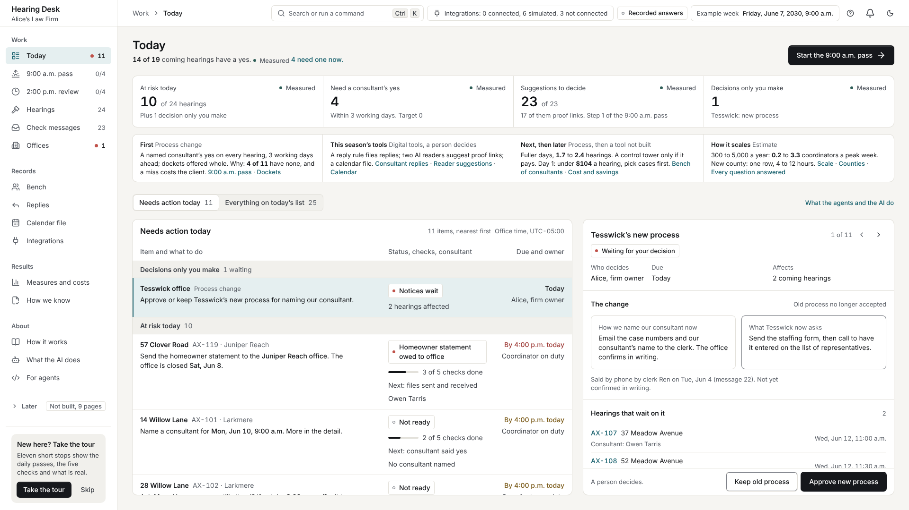
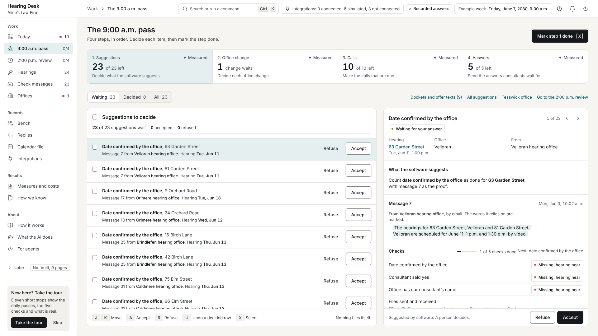
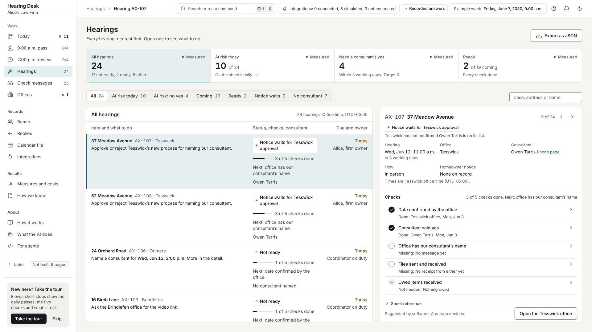
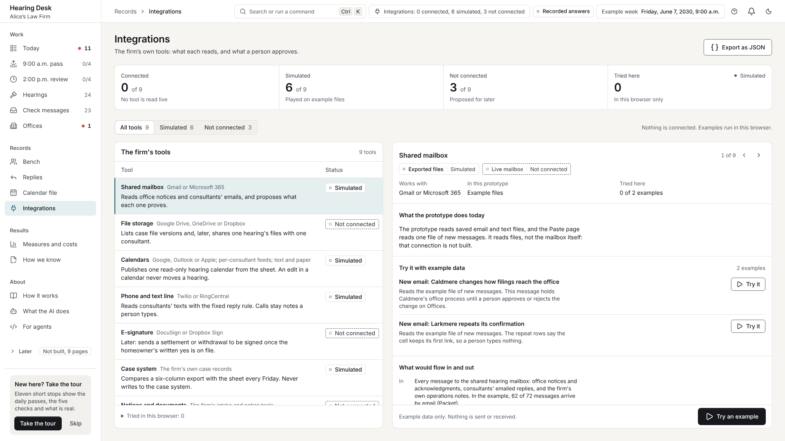
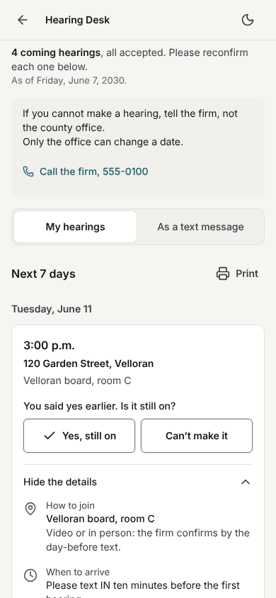

# Alice's Law Firm: hearing coordination

A take-home case for a Founder's Associate role at FairAppeal. The firm, its offices,
consultants, hearings and messages are fictional and come from the case's example packet.
Nothing in this repository sends a message or reads a real mailbox, and no API key is included.

**The task.** A small firm sends part-time consultants to property tax appeal hearings at county
offices, and hearings get missed. Choose the measures, set the order of work, design the process
for the first priority, build a prototype, and show how the approach scales. The brief is in
[docs/ASSIGNMENT.md](docs/ASSIGNMENT.md).



## The answer in five lines

1. **First, this season:** every hearing has a named consultant who has said yes, three working
   days ahead. The firm runs a daily kit, a spreadsheet with five checks on every hearing, and one
   small reply rule. No custom software is built this season.
2. **Next:** fuller consultant-days. Whole dockets go to one consultant, and offices are asked to
   hear the firm's cases on one day.
3. **Later:** a hearing control tower for a 5,000-hearing season. It is prototyped here and is not
   built for live use. A lean build costs $40,000 to $70,000 a year (estimate). It is built only if
   the firm's own timed minutes, counted by September, show that it pays in cash.
4. **Why first:** in the example week, 4 of the 11 hearings due within three working days have no
   consultant's yes (measured on the packet). A missed hearing costs the client and the firm.
5. **One number reverses the order:** if the fee a hearing earns is under the $104 a hearing
   costs (estimate), the firm first decides which cases go to a hearing.

**The ask:** two to four weeks of my time, three days of a coordinator, two hours a week of Alice
and three days of technical help. Set-up costs about $12,000 at 300 hearings a year (estimate).

## Walkthrough video

[media/hearing-desk-launch.mp4](media/hearing-desk-launch.mp4), with subtitles in
[media/hearing-desk-launch.srt](media/hearing-desk-launch.srt) and
[media/hearing-desk-launch.vtt](media/hearing-desk-launch.vtt). It shows each problem in the
brief, the page or file that handles it, and a live read with the two AI readers. It runs 10
minutes 34 seconds (1920x1080, H.264, 68 MB). GitHub does not play it inline: open the file and
choose "View raw" to download it.

## The three-minute tour

| Minute | Open | What to look at |
|---|---|---|
| 0 to 1 | [docs/write-up/one-page-write-up.pdf](docs/write-up/one-page-write-up.pdf) | Priorities, measures, process and cost on one page |
| 1 to 2 | `app/dist/index.html` (double-click; no install, no network) | Hearing Desk, the web app. The tour button runs eleven stops from How it works to How we know |
| 2 to 3 | [sheet/gate-sheet.xlsx](sheet/gate-sheet.xlsx) | The sheet a coordinator runs. Start with its "How to use" tab. The 24 example hearings are its rows |

Three pages to try in the app:

1. `#/today/9am`: the 9:00 a.m. pass, step by step. Accept or refuse a reader's suggestion.
2. `#/hearings/AX-107`: one hearing, its five checks and the message that proves each.
3. `#/offices/tesswick`: an office changed how it wants our consultant named. Approve or keep it.





## How to run

| Command | What it does | Needs |
|---|---|---|
| `make open` | Opens `app/dist/index.html` | A browser |
| `make tower` | Opens `prototype/control-tower.html`, the later control tower | A browser |
| `make check` | Runs the prototype's checks, the reply rule and the office rule | Node 22, no packages |
| `make sheet-check` | Checks the gate sheet against the 11 example threads and its rules | Python 3 with openpyxl, Node 22 |
| `make app` | Installs and builds the web app into `app/dist/index.html` | Node 22, network for `npm ci` |
| `make app-check` | Type check, smoke test and engine check of the app | The above, plus Playwright Chromium |

The last measured result of each command is in [CHECKS.md](CHECKS.md).

## Live AI mode (optional, your own key)

The offline file replays the readers' recorded answers. To read new messages live with the two AI
readers (gpt-6.1-sol reads, gpt-6-luna checks), run the app's server with an OpenAI key:

```
cd app
npm ci
npm run build
npm run live -- --key-file /path/to/key.txt --port 4180
```

Then open http://localhost:4180 and use "Paste new messages" or "Try it" on Integrations. The key
file holds the key alone or a line `OPENAI_API_KEY=...`; the variable `OPENAI_API_KEY` works too.
The key stays in the server process: it is not sent to the page, logged or written. After $5 of
spend in one server run (change it with `--cap <usd>`), the server falls back to recorded answers. Behind a proxy, set `NODE_USE_ENV_PROXY=1` and
`NODE_EXTRA_CA_CERTS`. Without a key, `npm run live:recorded` replays the recorded answers and says
so. The readers only suggest rows; a person accepts or refuses each one.

The same readers run from the command line in `prototype/` (`node cli/sheet.js --paste <file>`,
or `node eval/run.js` for the full evaluation), as described in
[prototype/README.md](prototype/README.md).

**Measured live on 22 Nov 2026** ([docs/evaluation/live-readers-22nov.md](docs/evaluation/live-readers-22nov.md)):

| Set | Agreed and verified readings that are right |
|---|---|
| 72 example messages, two runs | 117 of 117 and 119 of 119 |
| Unseen set 2, 100 everyday messages | 73 of 81, 90.1% (81.7% to 94.9%) |
| Unseen set 1, 30 hard office messages | 23 of 24 the answer key can judge |

275 fictional messages, 550 requests, 0 failed, $1.16 in all (measured from reported token usage
and the price table of 17 Nov 2026). The 72 examples were used while the instructions were written,
so they are not a fair test; unseen set 2 is.

## What is in the repository

```
app/          Hearing Desk, the web app: source, the live server and the built single file
prototype/    the season-one tools, the engine, the checks, the example data and
              control-tower.html
sheet/        gate-sheet.xlsx and how to open it in Excel, Google Sheets and LibreOffice
docs/         the brief, the write-up, the kit, the design, evaluation, outside tests and research
media/        screenshots and the walkthrough video with subtitles
```

The index of `docs/` is in [docs/README.md](docs/README.md). Every file is listed in
[FILES.md](FILES.md).

## Hearing Desk, the web app

Hearing Desk shows the season-one plan as a coordinator and a consultant use it. Every number is
read from the gate sheet or the engine and carries a label: measured, simulated, estimate or packet.

- **Today:** the 9:00 a.m. pass and the 2:00 p.m. review, in order.
- **Hearings:** each hearing's five checks, the message that proves each, and the next step.
- **Check messages and Replies:** the readers and the reply rule propose; a person decides.
- **Offices:** a changed office gets no notice until a person approves the change.
- **Integrations:** mailbox, file storage, calendar, phone and text, e-signature, case system and
  others, each marked Simulated or Not connected. None is connected.
- **Consultant page:** a phone page with a consultant's hearings and Yes, No and Can't make it.
- **Later:** the control tower pages, marked as not built this season.
- **How we know:** each check behind the numbers, with its command and the line it prints.

Agents can read the same data through `window.hearingDesk`, which has no method that writes
([docs/agents-api.md](docs/agents-api.md)).





## What is real and what is simulated

| Claim | Label |
|---|---|
| 4 of 11 hearings inside three working days with no consultant's yes | measured on the packet |
| The reply rule files 17 of the 39 example replies and hands 22 to a person; it agrees with a coordinator's decision on 39 of 39. The author of the rule wrote the replies | measured |
| 72 of 79 readings right where both AI readers agree and the verifier passes, on 100 unseen everyday messages (recorded); 73 of 81 in the live run of 22 Nov 2026 | measured |
| 216 of 216 automatic checks and 91 of 91 office-rule checks pass | measured |
| 180 pass lines and no FAIL line from the sheet check, including Part L of the sheet's rules (X32 to X34) | measured on the values LibreOffice 24.2 stored in the sheet |
| 0 differences in 893,010 cells between the sheet and an independent model of the written rules. This test ran before Part L, which has had no independent test | measured by an independent tester |
| 109 of 125 audit items answered Yes; 8 wait for the firm, 8 partly answered, 0 No | sourced from the audit, before Part L |
| $104 cost of a hearing today, of which $90 is the consultant's share | estimate; the $90 is sourced from the packet |
| 0 of 7 safety rules broken in 45,300 hearings of the control tower | simulated |
| 5.6 to 5.8 person-minutes a hearing with the tower, against 35.5 to 38.0 by hand | simulated, minutes estimated |
| 0.35 cents to read one message with both AI readers | measured |

The firm's own fees, minutes, misses and volume are not in the packet. Each has a cell on the
sheet's "Day 1 count" tab.

**What the prototype reads:** only the packet's fictional emails, texts, phone notes, one paper
notice, office instructions and packet files. It has no access to any real system.

## Limits

- No real mailbox, text line, calendar or case system is connected. New mail reaches the sheet
  only when a person exports it, runs a command and pastes the rows.
- The AI test sets are small and fictional, and unseen set 2 was written and labelled by AI.
  About 1 agreed reading in 10 on unseen everyday mail is wrong (7 of 79 recorded, 8 of 81 live),
  so auto-filing stays off and a person accepts every proposal.
- The sheet was built and checked in LibreOffice 24.2. Excel for Mac and Google Sheets ran on
  earlier builds only; Excel for Windows, the full sheet in Google Sheets and row actions were not
  tested ([docs/outside-tests/](docs/outside-tests/)).
- A block on a spreadsheet is words and order, not a lock.
- One workbook holds 39 offices, 40 consultants and 1,199 hearing rows (measured). Past that, kit
  appendix section 15 gives a procedure that was designed and not run.
- Part L of the sheet's rules passes the sheet's own check but has had no independent test.

## What is not done

| Gap | What a person does instead |
|---|---|
| No message says the day it arrived, or the day a paper notice came | The coordinator types the day on the sheet (Hearings DW and DX) |
| No office's phone number or street address is on record | The coordinator asks in the season email and leaves the cell at ASK until the office answers |
| No homeowner's phone or email is in the packet | The coordinator takes them from the client file before calling |
| No mailbox, text line or calendar is connected | The coordinator exports mail, runs one command and pastes the rows; a person imports the calendar file |
| The control tower is not built | The coordinator runs the daily kit and the sheet; the build decision is made in September on timed minutes |
| Excel, Google Sheets and the calendar import ran on earlier builds only | Open the sheet in LibreOffice 24.2; test the firm's own program before the season |
| The readers know only the 24 packet hearings | The firm's own rows are typed on the sheet; nothing reads the case system |
| Minutes and money are estimates; nobody has timed the firm | The firm counts its own minutes and fees by September (Day 1 count tab) |

## License and data

Code is under the MIT license ([LICENSE](LICENSE)). All example data is fictional; any
resemblance to a real name, address or office is unintended.
